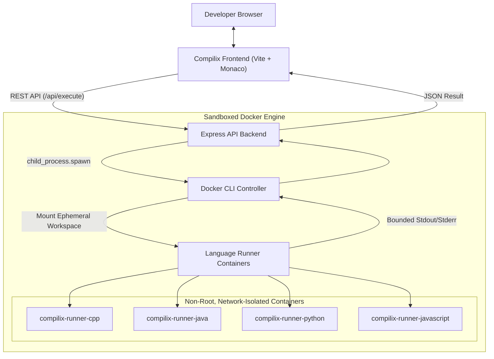

# Compilix — Modern Online Compiler

Compilix is a modern, deployment-friendly online compiler featuring a LeetCode-inspired user interface, native Monaco Editor integration, and sandboxed, multi-language code execution powered by isolated Docker containers.

```
       _____                      _ _ _      
      / ____|                    (_) (_)     
     | |     ___  _ __ ___  _ __  _| |___  __
     | |    / _ \| '_ ` _ \| '_ \| | | \ \/ /
     | |___| (_) | | | | | | |_) | | | |>  < 
      \_____\___/|_| |_| |_| .__/|_|_|_/_/\_\
                           | |               
                           |_|               
```

---

## 🌟 Key Features

- **LeetCode-Inspired Developer Workspace**: Sleek dark-charcoal theme, two-column layout, responsive panels, clean typography, and zero clutter.
- **Monaco Editor Integration**: Native Vite bundling of Monaco Editor (the editor powering VS Code) with full syntax highlighting, bracket matching, line numbers, and code folding.
- **Multi-Language Support**:
  - **C++**: GCC 14 with C++17
  - **Java**: OpenJDK 21
  - **Python**: Python 3.12
  - **JavaScript**: Node.js 22
- **Independent Language Buffers**: Separate code models ensure your code in C++, Java, Python, or JavaScript is never overwritten when switching languages.
- **Isolated Docker Sandboxing**:
  - Network isolation (`--network none`)
  - Strict resource limits (`--memory 256m --cpus 1.0 --pids-limit 64`)
  - Non-root execution (`runner` / `node` UID 1000)
  - Dropped Linux capabilities (`--cap-drop ALL`)
  - Prevention of privilege escalation (`--security-opt no-new-privileges`)
  - Ephemeral container and workspace lifecycle
- **Custom Standard Input (stdin)**: Easily provide multi-line standard input to programs.
- **Accurate Error Distinction**: Clear classification between `success`, `compilation_error`, `runtime_error`, `time_limit_exceeded`, `output_limit_exceeded`, and `execution_error`.
- **Resizable Bottom Console Panel**: Draggable horizontal divider to adjust between editor and console with Input, Output, and Errors tabs.
- **Persistent Preferences**: LocalStorage persistence for active code, custom stdin, theme (Dark / Light), and editor settings (font size, tab size, word wrap, minimap).
- **Zero Question/Judge Bloat**: Designed strictly as a general-purpose online compiler, not a competitive programming problem platform.

---

## 📸 Screenshots

| Dark Theme Workspace | Console Tabs & Execution |
| :---: | :---: |
|  |  |

---

## 🛠️ Technology Stack

| Layer | Technologies |
| :--- | :--- |
| **Frontend** | HTML5, CSS3 (Vanilla CSS variables), Vanilla JavaScript (ESM), Vite 6, Monaco Editor 0.52 |
| **Backend** | Node.js 22+, Express.js 4, CORS, express-rate-limit, dotenv |
| **Code Execution** | Docker Engine, GCC 14 (Alpine), OpenJDK 21 (Alpine), Python 3.12 (Alpine), Node.js 22 (Alpine) |
| **Tooling & Orchestration** | npm workspaces, concurrently, Docker Compose, GitHub Actions |

---

## 🏛️ System Architecture



For complete architectural details, consult [docs/architecture.md](docs/architecture.md).

---

## 📁 Project Directory Structure

```
Compilix/
├── .github/
│   └── workflows/
│       └── ci.yml               # Automated CI (lint, build runners, test, build frontend)
├── backend/
│   ├── src/
│   │   ├── config/env.js        # Validated environment configuration
│   │   ├── controllers/         # Health, languages, and execution controllers
│   │   ├── middleware/          # Rate limiting and centralized error handlers
│   │   ├── routes/              # Express API routes
│   │   ├── services/            # Docker sandboxing and execution orchestration
│   │   ├── utils/errors.js      # Custom error classes
│   │   ├── validators/          # Schema and payload size validation
│   │   ├── app.js               # Express application pipeline
│   │   └── server.js            # Server entrypoint and graceful shutdown
│   ├── tests/api.test.js        # Unit and live Docker integration tests
│   ├── Dockerfile               # Containerized API backend
│   └── package.json
├── docker/
│   └── runners/
│       ├── cpp/                 # C++ runner Dockerfile & run.sh
│       ├── java/                # Java runner Dockerfile & run.sh
│       ├── python/              # Python runner Dockerfile & run.sh
│       └── javascript/          # JavaScript runner Dockerfile & run.sh
├── docs/
│   ├── architecture.md          # Comprehensive architecture with Mermaid diagrams
│   ├── setup.md                 # Local setup and workflow instructions
│   ├── deployment.md            # Production deployment and topology
│   ├── security.md              # Threat model and sandbox defense in depth
│   └── api.md                   # REST API documentation
├── frontend/
│   ├── public/favicon.svg       # Compilix brand icon
│   ├── src/
│   │   ├── js/                  # App, editor, console, theme, storage, and API modules
│   │   ├── styles/              # Design tokens, base, layout, components, responsive
│   │   └── index.html           # Main SPA HTML structure
│   ├── vite.config.js           # Vite config with Monaco worker and proxy configuration
│   ├── Dockerfile               # Multi-stage production Nginx frontend container
│   └── package.json
├── scripts/
│   ├── build-runners.js         # Docker runner image build automation
│   └── check-environment.js     # Diagnostic environment checker
├── docker-compose.yml           # Multi-container orchestration
├── package.json                 # Monorepo workspaces & dev scripts
└── README.md
```

---

## 🚀 Quickstart & Local Setup

### 1. Prerequisites
- **Node.js** (v18.0.0 or higher)
- **npm** (v9.0.0 or higher)
- **Docker Engine or Docker Desktop** (running)

### 2. Install Dependencies
```bash
git clone https://github.com/your-org/Compilix.git
cd Compilix
npm install
```

### 3. Verify Environment & Build Runner Images
```bash
npm run check:env
npm run build:runners
```

### 4. Run Frontend and Backend Together
```bash
npm run dev
```

Visit `http://localhost:5173` to start writing and running code.

---

## 🧪 Testing

Compilix includes automated tests for route contracts, validation edge cases, and real Docker execution for all 4 languages:

```bash
npm run test
```

Output:
```
✔ Compilix API Tests
  ✔ GET /api/health
  ✔ GET /api/languages
  ✔ POST /api/execute - Validation and Error Handling
  ✔ Docker Execution Integration Tests (Python, JS, C++, Java)
ℹ tests 17 | pass 17 | fail 0
```

---

## 🔒 Security Architecture Highlights

Compilix enforces multi-layered defense in depth:
- **Zero Network Access**: All containers execute with `--network none`.
- **Resource Constraints**: Hard limits on memory (`256m`), CPU (`1.0`), and thread/process count (`pids-limit 64`).
- **Bounded Output**: Output streams are capped at `256 KB` to prevent memory flooding.
- **Strict Timeouts**: Automatic termination after `10,000ms`.
- **Non-Root Execution**: Runs under UID `1000:1000` with `--cap-drop ALL` and `--security-opt no-new-privileges`.
- **Ephemeral Storage**: Workspaces are isolated per-run and cleaned up immediately.

For full threat modeling and sandbox boundaries, see [docs/security.md](docs/security.md).

---

## 📄 License

This project is licensed under the MIT License.
