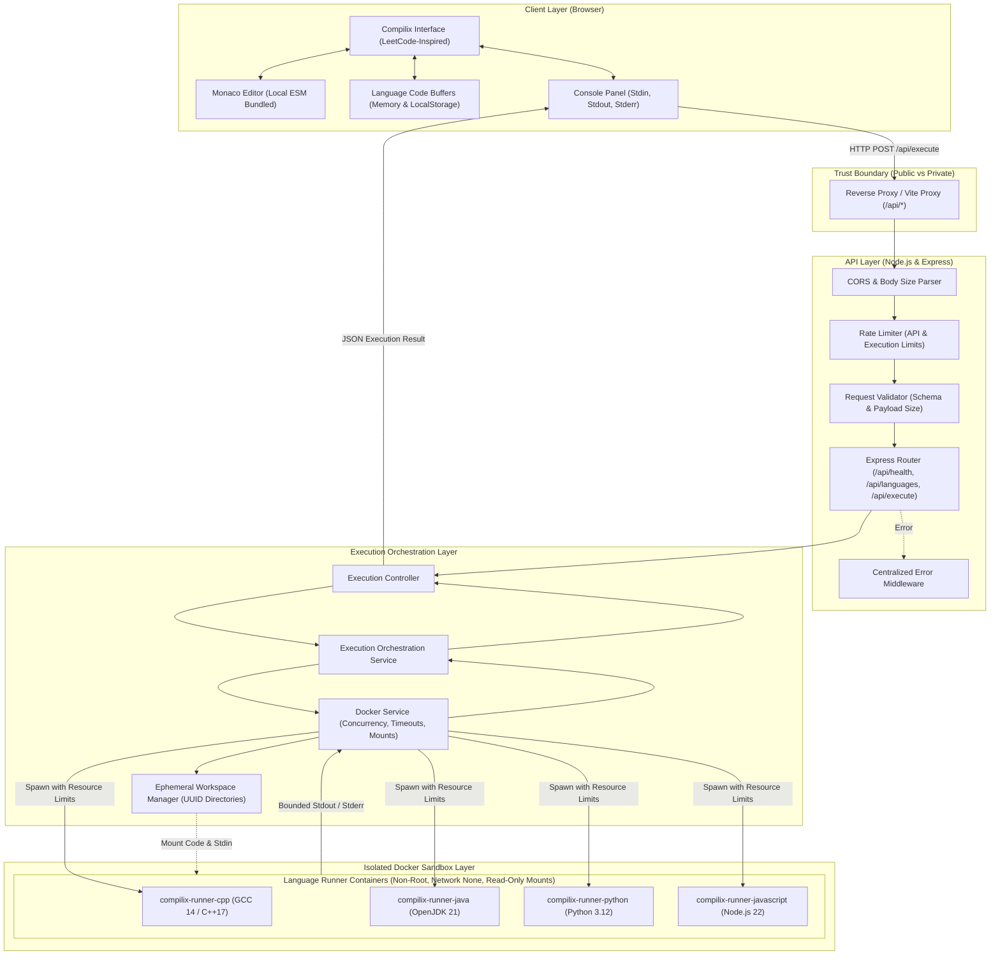
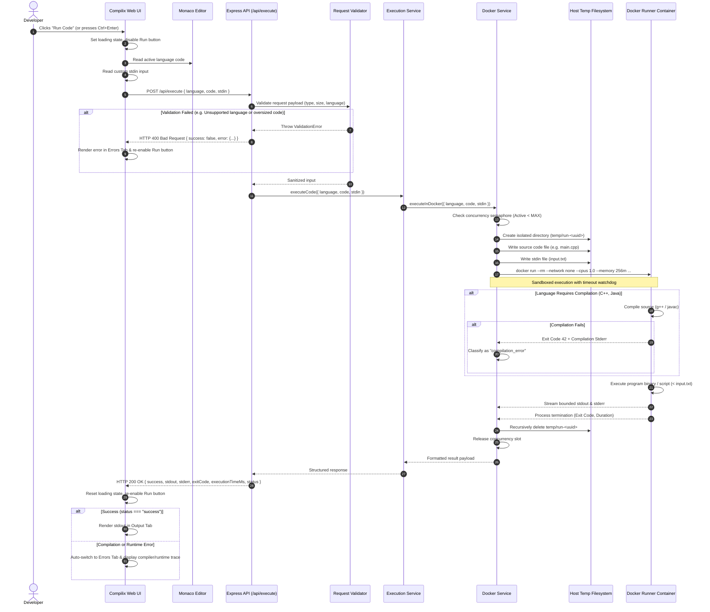
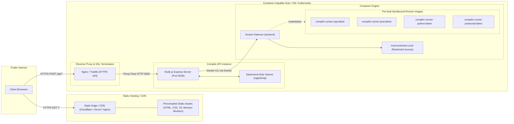
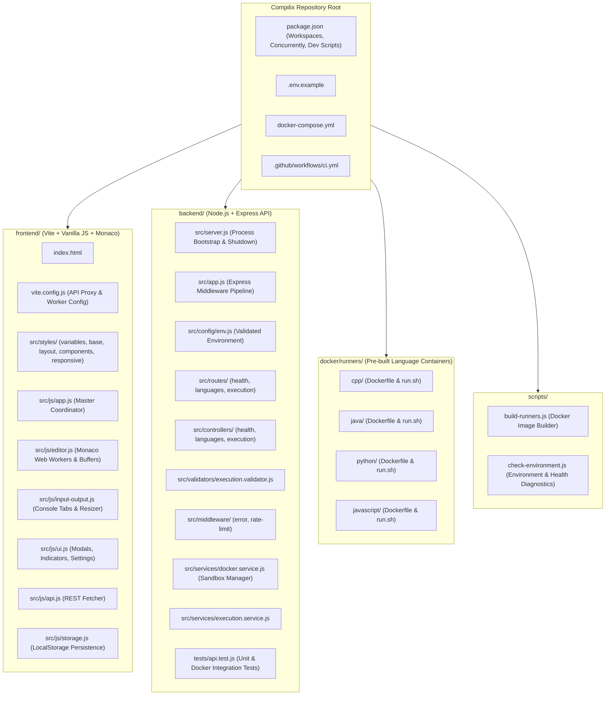

# Compilix — System Architecture

This document provides the complete system architecture for **Compilix**, a deployment-friendly online code compiler with a LeetCode-inspired user interface and sandboxed Docker container execution.

---

## 1. High-Level System Architecture

The following diagram illustrates the relationship between the client layer, API gateway layer, execution orchestration layer, and isolated container execution layer.

---

## 2. Code Execution Sequence Diagram

The sequence below details the complete lifecycle of an execution request from the moment the developer triggers the **Run** action until the parsed output is rendered.

---

## 3. Deployment Architecture

Compilix is architected for independent, production-grade deployment across static hosting and container infrastructure.

---

## 4. Project Module Architecture

The following diagram maps application responsibilities to the actual physical repository files:

---

## 5. Architectural Summary & Component Responsibilities

### 1. Client Layer (Frontend)
- **Responsibility**: Provides the responsive, LeetCode-inspired workspace, hosts the Monaco Editor with language-specific syntax highlighting, manages independent code buffers in memory and `localStorage`, allows custom `stdin` specification, and formats execution stdout/stderr with real-time status badges.
- **Design Decisions**:
  - Built with Vanilla JavaScript and native Vite workers to avoid framework overhead while maintaining modularity.
  - Separate code buffers ensure developers never lose code when switching between C++, Java, Python, and JavaScript.
  - Relative API paths (`/api/*`) are proxied during development and served via reverse proxy in production.

### 2. API Gateway & Validation Layer (Backend)
- **Responsibility**: Serves as the public-facing entry point. Applies CORS policies, rate limiting, request body parsing limits, and strict schema validation.
- **Design Decisions**:
  - All input is sanitized and validated before reaching execution services.
  - Concurrency is throttled to prevent resource exhaustion attacks.
  - Distinguishes basic API uptime from execution engine readiness via `/api/health`.

### 3. Execution Orchestration Layer
- **Responsibility**: Allocates a unique ephemeral directory (`temp/run-<uuid>`), writes user source code and input files, coordinates Docker container lifecycles, enforces timeouts, captures bounded output streams, and cleans up temporary files and containers.
- **Design Decisions**:
  - Never passes untrusted code as shell arguments; file-based mounts ensure zero shell injection vulnerabilities.
  - Independent exit-code classification cleanly separates compilation errors (`status: compilation_error`) from runtime exceptions (`status: runtime_error`).

### 4. Sandboxed Execution Layer (Docker Runners)
- **Responsibility**: Executes untrusted user code in short-lived, isolated Linux containers.
- **Isolation Controls**:
  - `network: none`: Absolute network cutoff prevents outbound socket connections, SSRF, or malware downloads.
  - `user: 1000:1000`: Runs under unprivileged non-root users (`runner` / `node`).
  - `--cap-drop ALL` & `--security-opt no-new-privileges`: Strips all Linux kernel capabilities and prevents privilege escalation.
  - `--memory 256m --cpus 1.0 --pids-limit 64`: Enforces strict RAM, CPU, and fork bomb limits.
